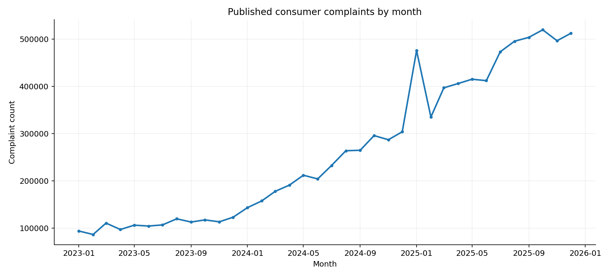
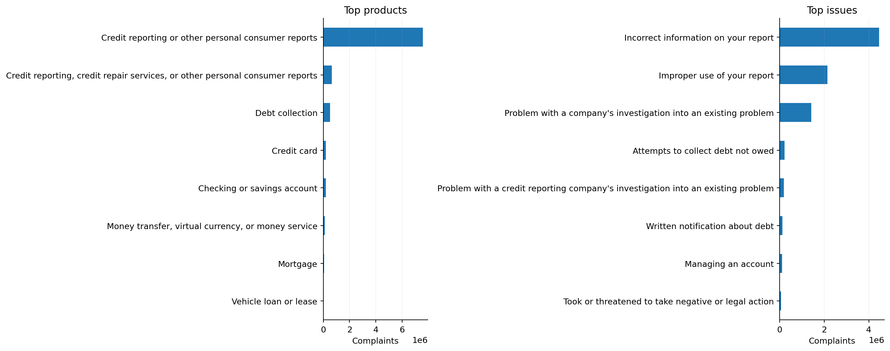
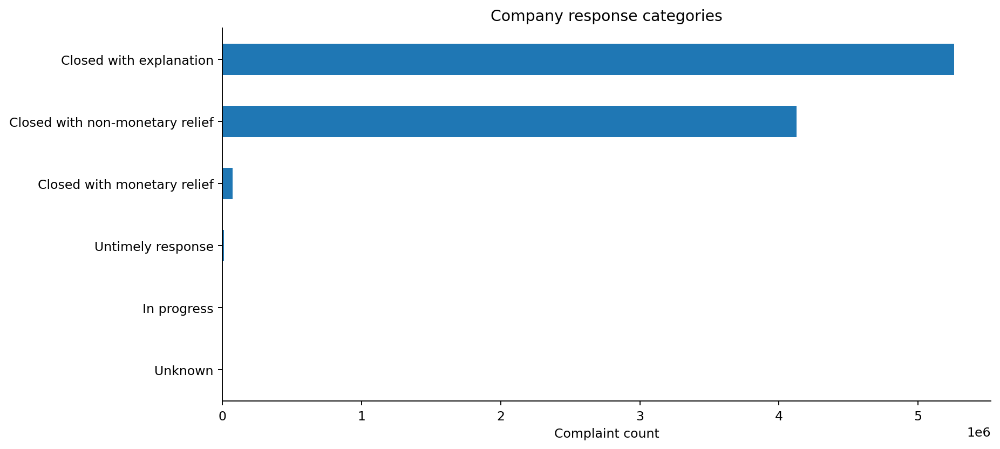
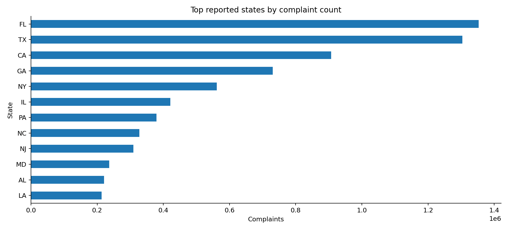

# Banking Intelligence 360

**U.S. Financial Consumer Complaint Analytics (2023–2025)**  
**Tools:** Python · pandas · SQLite SQL · Matplotlib · Jupyter Notebook

## Project overview

An end-to-end analysis of published U.S. Consumer Financial Protection Bureau (CFPB) complaints. The project examines monthly and annual trends, product and issue concentration, response timeliness, company and state distributions, and emerging issue signals. It converts a large public dataset into actionable descriptive analysis.

## Results at a glance

| KPI | Observed result |
|---|---:|
| Published complaints analyzed | **9,469,257** |
| Companies represented | **5,150** |
| Product categories | **14** |
| Recorded timely response rate | **99.60%** |

These metrics were observed from a run of the 2023–2025 extract. The CFPB source can change as records are updated; fresh runs may differ. A timely response is **not** proof of satisfactory resolution.

## Analytical questions

1. How have complaint volumes changed over time?
2. Which products and issues account for the most published complaints?
3. How do recorded response categories and timeliness vary?
4. Which product–issue pairs increased between July–September and October–December 2025?
5. Where are published complaints concentrated geographically?

## Methods and deliverables

- **Data preparation:** column checks, date filtering, missing-value treatment, and complaint-ID validation.
- **Exploratory analysis:** trend charts, concentration metrics, and response breakdowns.
- **SQL:** SQLite queries with common table expressions (CTEs), aggregations, `LAG`, and ranking window functions.
- **Emerging issue screening:** quarter-over-quarter changes in product–issue combinations with a minimum baseline of 100 complaints; descriptive, not predictive.
- **Outputs:** nine aggregated CSV tables, four PNG figures, SQL script, SQLite database, and a generated executive summary.

## Analysis visuals

The figures below were generated from the 2023–2025 CFPB extract using the notebook.

### Monthly complaint trend


### Product and issue concentration


### Company response categories


### Geographic distribution


## Selected business insights

- Complaint volumes are concentrated in a limited set of product categories, warranting closer issue-level monitoring.
- The **99.60%** timely-response figure describes recorded timeliness, **not** resolution quality or customer satisfaction.
- Company-level complaint counts should not be interpreted as complaint rates without customer-base or market-share denominators.
- High-growth product–issue combinations are screening signals to investigate, not evidence of causation or wrongdoing.

For specific top categories and growth estimates, run the notebook to generate `outputs/EXECUTIVE_SUMMARY.md`.

## Repository contents

```text
Banking_Intelligence_360.ipynb  # Reproducible Python + SQL analysis
README.md                       # Project overview
requirements.txt                # Python dependencies
.gitignore                      # Excludes raw data and local databases
outputs/                        # Optional small exports and charts from a completed run
```

## How to reproduce

1. Install Python packages: `pip install -r requirements.txt`.
2. Open `Banking_Intelligence_360.ipynb` in Jupyter.
3. Run cells in order. On the first run, the notebook reads the [official CFPB CSV ZIP](https://files.consumerfinance.gov/ccdb/complaints.csv.zip) (or a local file at `data/complaints.csv.zip` / `data/complaints.csv`). The first run may take significant time and memory.
4. Inspect the generated tables, figures, SQL queries, and `outputs/EXECUTIVE_SUMMARY.md`.

**Note:** No raw complaint dataset is included in this repository. This is a Python/SQL analytics project; no Power BI dashboard is claimed.

## Data provenance

- [CFPB Consumer Complaint Database](https://www.consumerfinance.gov/data-research/consumer-complaints/)
- [Official downloadable CSV ZIP](https://files.consumerfinance.gov/ccdb/complaints.csv.zip)

## Limitations

CFPB complaints are not a representative sample of all consumers. Complaint counts are not normalized by institution size or customers served. Timeliness does not measure satisfaction, resolution quality, or misconduct. Publication and classification practices can affect trends. Findings are descriptive, not causal.
