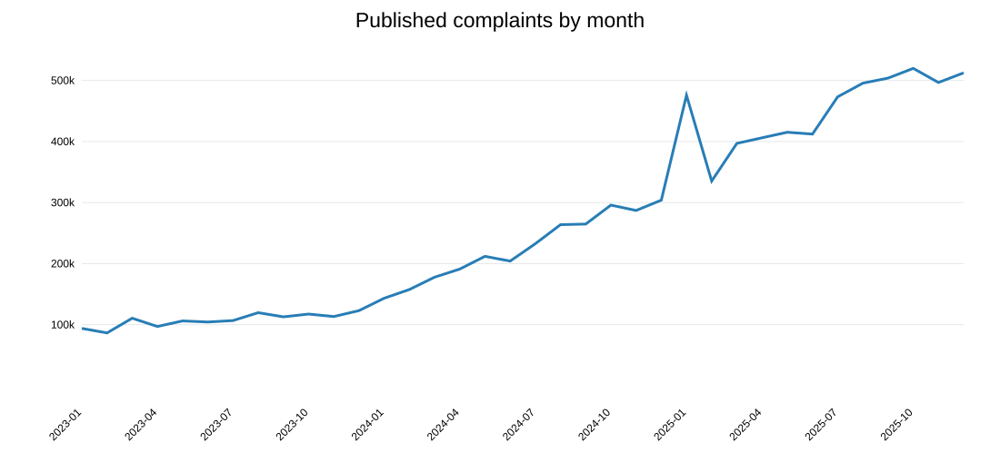
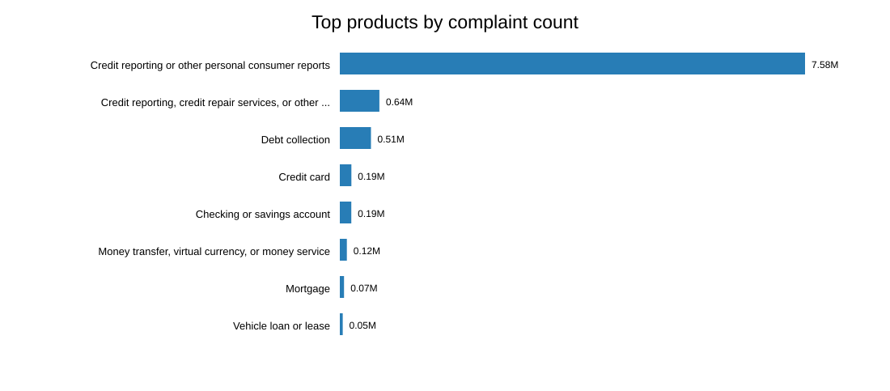
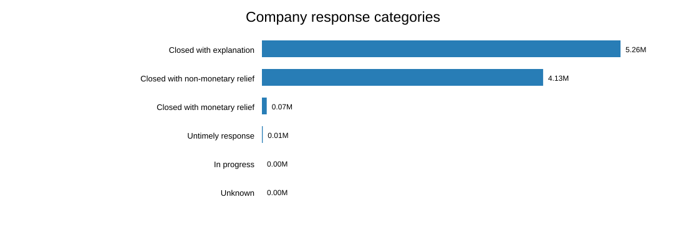
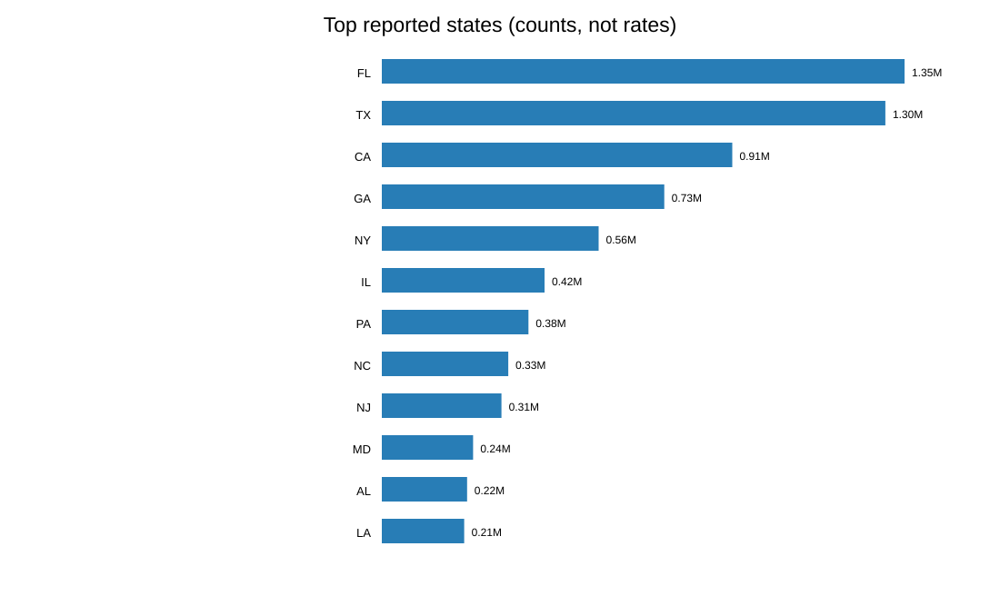

# Banking Intelligence 360

### U.S. Financial Consumer Complaint Analysis | 2023–2025

**Tools:** Python · pandas · Matplotlib · SQLite SQL · Jupyter Notebook

## Project overview

This project analyzes consumer complaints published by the U.S. Consumer Financial Protection Bureau (CFPB) between 2023 and 2025. The goal is to understand how complaint volumes changed over time, identify the most frequently reported financial products and issues, examine company responses, and flag product–issue combinations with notable recent increases.

The analysis focuses on descriptive findings that can help prioritize further investigation, rather than making claims about service quality or the causes of complaint growth.

## Key findings

| Metric | Result |
|---|---:|
| Published complaints analyzed | **9,469,222** |
| Companies represented | **5,148** |
| Product categories | **14** |
| Timely responses among records marked Yes/No | **99.6%** |
| Increasing product–issue pairs in Q3 vs Q4 2025 (Q3 baseline ≥ 100) | **50** |

*These results reflect the saved notebook run. The live CFPB database may be updated, so counts can differ when the analysis is rerun.*

### What stood out

- **Strong upward trend:** Published complaints increased from **1,292,043 in 2023** to **2,734,253 in 2024** and **5,442,926 in 2025**. Year-over-year increases were approximately **111.6%** and **99.1%**, respectively.
- **Concentration in credit reporting:** **Credit reporting or other personal consumer reports** was the largest product category, accounting for approximately **80.0%** of complaints in the extract.
- **Common issues:** The most frequent reported issues included **incorrect information on a credit report**, **improper use of a report**, and concerns about companies' investigations of reported problems.
- **Response outcomes:** Most records were categorized as **closed with explanation** or **closed with non-monetary relief**. Timely responses do not necessarily mean that customers were satisfied or that complaints were resolved in their favor.
- **Emerging issue screening:** **50 product–issue pairs** met the screening criteria of at least 100 Q3 complaints and a positive increase in Q4 2025. For example, the debt-collection issue concerning threatened negative or legal action increased from **11,969** to **24,056** complaints (approximately **101%**).

## Business questions

1. How did published complaint volumes change by month and year?
2. Which financial products and issues accounted for the most complaints?
3. How were company responses distributed, and how often were responses recorded as timely?
4. Which product–issue combinations increased from Q3 to Q4 2025?
5. In which reported states were complaints concentrated?

## Analytical approach

1. **Data loading:** Read the official CFPB CSV ZIP in chunks, select relevant columns, and filter complaint dates to 2023–2025.
2. **Data quality:** Inspect missing values and duplicate complaint IDs; standardize text fields and create year, month, and quarter variables.
3. **KPI reporting:** Calculate total complaints, company and product counts, and the timely response rate using only known `Yes`/`No` values.
4. **Trend analysis:** Compare monthly complaint counts and annual year-over-year growth.
5. **Product and issue analysis:** Rank complaint categories and calculate each product's share of total published complaints.
6. **Company response analysis:** Summarize response categories and company-level timeliness; focus the company comparison on those with at least 1,000 complaints.
7. **Emerging issue screening:** Compare product–issue counts for July–September (Q3) and October–December (Q4) 2025. Retain combinations with at least 100 complaints in Q3 and positive absolute growth; rank by percentage growth.
8. **Geographic distribution:** Summarize complaint counts by reported state.
9. **Basic SQL:** Store an aggregated monthly product table in SQLite and use `SELECT`, `SUM`, `GROUP BY`, and `ORDER BY` to summarize product complaints.

## Visualizations

The notebook generates four PNG figures in the `outputs/` folder. The charts shown below are SVG reproductions made from the saved summary tables:

- `01_monthly_trend.png` — monthly published complaint volumes
- `02_top_products.png` — top products by complaint count
- `03_responses.png` — company response categories
- `04_states.png` — states with the highest reported complaint counts


### Monthly complaint trend


### Top products


### Company response categories


### Geographic distribution


## Repository contents

```text
Banking_Intelligence_360.ipynb   Main analysis notebook
README.md                        Project overview and findings
requirements.txt                 Python dependencies
.gitignore                       Excludes local data and generated files
outputs/                         Created when the notebook runs
```

The notebook also exports **nine aggregated CSV summary tables** and creates a small SQLite database in `outputs/`. The original multi-million-row dataset is not included in this repository.

## How to run

1. Install Python and Jupyter Notebook.
2. Install the required packages:

   ```bash
   pip install -r requirements.txt
   ```

3. Open `Banking_Intelligence_360.ipynb` in Jupyter.
4. Run the cells from top to bottom. The notebook downloads the official CFPB CSV ZIP and may take time and substantial memory to process.
5. Review the printed findings, tables, charts, and generated `outputs/` files.

## Data source

- [CFPB Consumer Complaint Database](https://www.consumerfinance.gov/data-research/consumer-complaints/)
- [Official CFPB CSV ZIP](https://files.consumerfinance.gov/ccdb/complaints.csv.zip)

## Limitations and next steps

- The dataset contains **published complaints**, not a representative sample of all U.S. financial-services customers.
- Complaint counts are **not adjusted for company size, number of customers, or population**. Higher volumes do not, by themselves, indicate poorer service.
- Recorded response timeliness is different from **resolution quality** and **customer satisfaction**.
- A quarter-over-quarter increase is a **descriptive screening signal**, not proof of causation or misconduct. The minimum Q3 baseline of 100 is a practical threshold, and smaller emerging issues may require separate review.
- Changes in reporting, complaint publication, or product classification may affect comparisons over time.

A useful next step would be to compare these patterns with institution-level customer counts and internal complaint data to calculate more comparable complaint rates and investigate the underlying drivers.